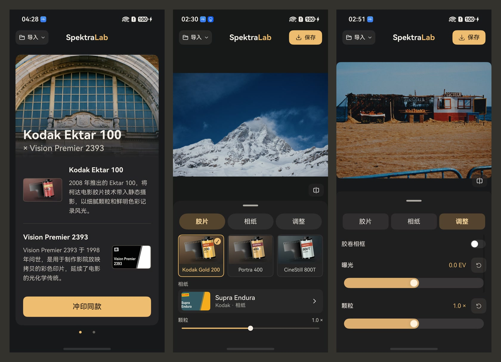

# SpektraLab for HarmonyOS

中文：[README_zh.md](README_zh.md)

SpektraLab is now available on the HarmonyOS app store. SpektraLab is a film darkroom for HarmonyOS. Start with a photo or camera RAW file, then choose both the film stock and the material it prints onto. Try Kodak Gold 200 on Portra Endura paper, or pair Ektar 100 with Vision Premier 2393 motion-picture print film.



## Make your first print

1. **Pick a starting point.** Swipe through the sample prints on the home screen and tap **冲印同款** to apply that pairing to your own photo. To start with the original image, import from the gallery or file picker.
2. **Choose your materials.** Explore 25 film profiles, including color negatives, slide film and black-and-white stocks, and 9 print materials. Choosing one material fills in its default partner. Change the pairing to see how the print responds.
3. **Fine-tune the print.** Adjust exposure, grain, halation and glare. Hold the comparison control to check the original, or enable a film frame to include it in the export.
4. **Save at full resolution.** Export to the gallery as JPEG, PNG or HEIF on devices with HEIF encoding. The filename records the film and print material so you can revisit the pairing.

## Build from source

The app pairs an ArkTS interface with the C++/Vulkan engine from [SpektraLab](https://github.com/JamesQiu2005/SpektraLab). The commands below target arm64 on HarmonyOS using a macOS build host.

Install DevEco Studio with the HarmonyOS 26.0.0 SDK and native toolchain. Make Git, Ninja, jq, rsync, uv and a host glslang executable available. The native build script was tested with glslang 16.0.0.

From the root of this repository, fetch the pinned engine and stage its native library, profiles and license notices:

```sh
git clone --recurse-submodules https://github.com/JamesQiu2005/SpektraLab.git ../SpektraLab-engine
git -C ../SpektraLab-engine checkout 445e314e28b9b455d2457471fadaffd28c07270b
git -C ../SpektraLab-engine submodule update --init --recursive

export SPEKTRALAB_SOURCE_DIR="$(cd ../SpektraLab-engine && pwd)"
export GLSLANG="$(command -v glslang)"
cp -n build-profile.example.json5 build-profile.json5
bash scripts/build-native.sh
bash scripts/stage-app.sh
```

If your native SDK is outside DevEco Studio’s default macOS location, set `OHOS_NATIVE_SDK` before running the build. Open this repository in DevEco Studio, configure debug signing for your device, then run the `entry` module.

## Project links

- [HarmonyOS interface and editing workflow](entry/src/main/ets)
- [Native renderer and RAW decoder](native)
- [Version 1.0.0 release notes (Chinese)](dev/releases/1.0.0.md)

## License and credits

The HarmonyOS application is licensed under the GNU General Public License, version 3 or any later version (`GPL-3.0-or-later`). It is based on SpektraLab. The HarmonyOS port adds the ArkTS interface, the native bridge and changes to the Vulkan backend. See the [GPL license](LICENSE) and the [upstream version used by this port](https://github.com/JamesQiu2005/SpektraLab/tree/445e314e28b9b455d2457471fadaffd28c07270b).

The film and paper profiles and print LUTs derived from **spektrafilm** by **Andrea Volpato** are licensed under CC BY-SA 4.0. Redistributed adaptations must credit the source, identify changes and retain the same license. You keep the rights to photographs you process with these materials. See [spektrafilm](https://github.com/andreavolpato/spektrafilm) and the [materials license](licenses/SPEKTRAFILM_LICENSE.txt).

Third-party components, including LibRaw and libjpeg-turbo, retain their own licenses. Their notices are bundled with the app. Sample photographs and packaging images remain subject to their respective rights holders’ terms.
