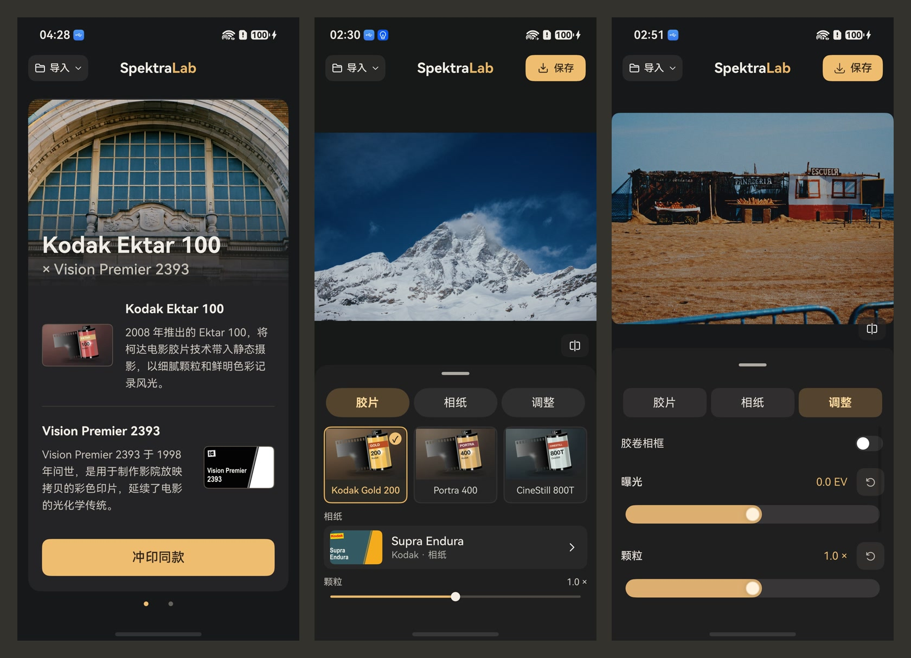

# SpektraLab 鸿蒙版

[English](README.md)

SpektraLab 现已上架鸿蒙应用商店。SpektraLab 是鸿蒙上的胶片暗房。导入照片或相机 RAW 原片，先选胶卷，再决定把它印在什么材料上。可以从 Kodak Gold 200 搭配 Portra Endura 相纸开始，也可以试试 Ektar 100 印到 Vision Premier 2393 电影正片上的效果。



## 冲印第一张照片

1. **从样张或原图开始。** 横滑浏览首页样张，点「冲印同款」，就能给自己的照片套用这组材料。也可以从相册或文件导入，先看原图。
2. **搭配胶卷与输出材料。** 25 种胶片配置涵盖彩色负片、反转片和黑白胶片，另有 9 种输出材料。选中一种材料后，应用会补齐默认搭配。保留同一卷胶片、换一种相纸，就能直观看到纸面对成片的影响。
3. **微调成片。** 调整曝光、颗粒、光晕和眩光，按住对比按钮查看原图。喜欢带框的照片，可以打开胶卷相框，一起保存。
4. **全尺寸保存。** 成片以原始分辨率写入相册，可选 JPEG、PNG，支持 HEIF 编码的设备还可选 HEIF。文件名会带上胶卷和输出材料型号，方便日后找回同一组搭配。

## 从源码构建

鸿蒙版使用 ArkTS 编写界面，冲印由上游 [SpektraLab](https://github.com/JamesQiu2005/SpektraLab) 的 C++/Vulkan 引擎完成。以下步骤适用于 macOS 构建主机，目标为 arm64 鸿蒙设备。

安装 DevEco Studio、HarmonyOS 26.0.0 SDK 和原生工具链，并准备 Git、Ninja、jq、rsync、uv 和可在主机运行的 glslang。原生构建脚本使用 glslang 16.0.0 验证过。

在本仓库根目录执行以下命令，获取指定版本的引擎，并将原生库、材料配置和第三方许可文件放入应用模块：

```sh
git clone --recurse-submodules https://github.com/JamesQiu2005/SpektraLab.git ../SpektraLab-engine
git -C ../SpektraLab-engine checkout 445e314e28b9b455d2457471fadaffd28c07270b
git -C ../SpektraLab-engine submodule update --init --recursive

export SPEKTRALAB_SOURCE_DIR="$(cd ../SpektraLab-engine && pwd)"
export GLSLANG="$(command -v glslang)"
cp -n build-profile.example.json5 build-profile.json5
bash scripts/build-native.sh
bash scripts/stage-app.sh
```

如果原生 SDK 位于 DevEco Studio 的 macOS 默认路径之外，先设置 `OHOS_NATIVE_SDK`。用 DevEco Studio 打开本仓库，为目标设备配置调试签名，然后运行 `entry` 模块。

## 项目导航

- [鸿蒙界面与编辑流程](entry/src/main/ets)
- [原生渲染与 RAW 解码](native)
- [1.2.0 版本更新说明](dev/releases/1.2.0.md)

## 许可与致谢

鸿蒙版应用采用 GNU 通用公共许可证第 3 版或任何后续版本（`GPL-3.0-or-later`）。本项目基于 SpektraLab 开发，鸿蒙移植部分包括 ArkTS 界面、原生桥接和对 Vulkan 后端的修改。详见 [GPL 许可正文](LICENSE) 和[本项目使用的上游版本](https://github.com/JamesQiu2005/SpektraLab/tree/445e314e28b9b455d2457471fadaffd28c07270b)。

源自 **Andrea Volpato** 的 **spektrafilm** 项目的胶片与相纸配置、印片 LUT 采用 CC BY-SA 4.0。再分发改编材料时，须保留署名、标明修改，并以相同许可分享。你使用这些材料冲印自己的照片，仍保有照片的权利。详见 [spektrafilm 原项目](https://github.com/andreavolpato/spektrafilm) 和[材料许可正文](licenses/SPEKTRAFILM_LICENSE.txt)。

LibRaw、libjpeg-turbo 等第三方组件沿用各自许可，许可声明随应用分发。样张和包装图片的使用遵循各权利人的授权条款。
