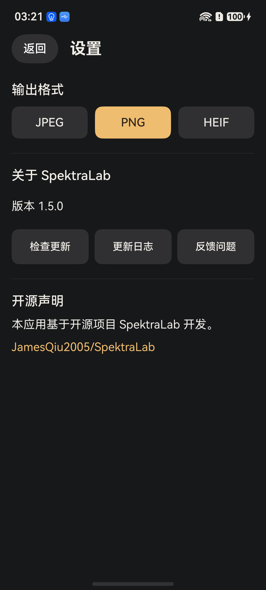
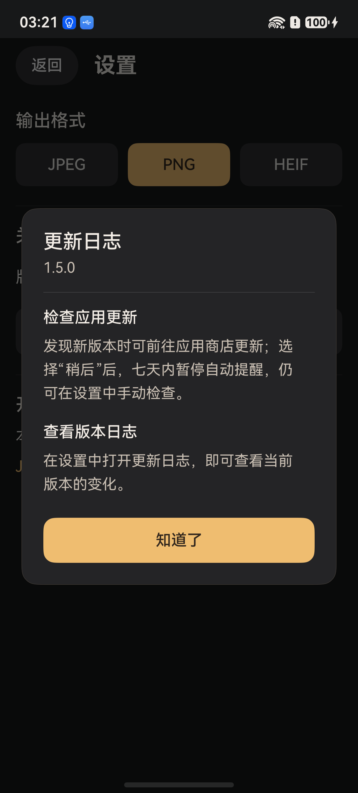
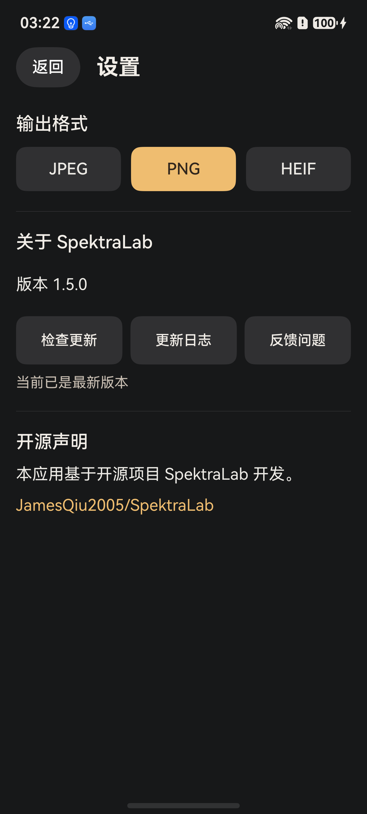
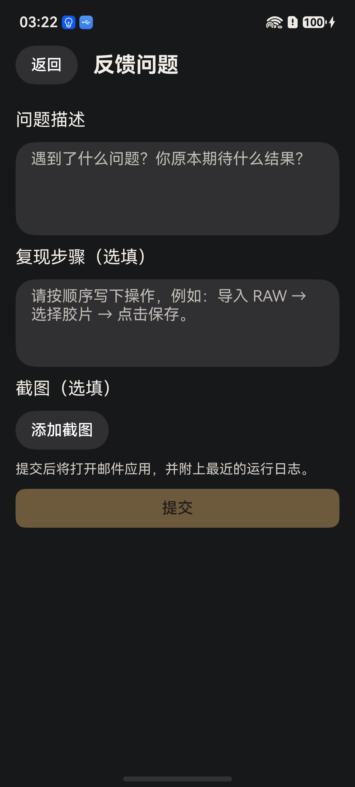

## SpektraLab 1.5.0 发行复审

**第二轮候选 · 材料和截图复核通过** · 版本码 10 · 对照 1.4.0 · 北京时间 2026-11-18

构建源码：`8eeca4e3a0f5382a4ac6b574c7acd7b20df6cea8`

### 更新内容

- 发现新版本时可前往应用商店更新；选择稍后可暂停自动提醒七天
- 设置页可手动检查更新，并查看当前版本日志
- 设置页将检查更新、更新日志与反馈问题放在版本号下方的同一行

### 商店更新日志

发现新版本时可前往应用商店更新；选择“稍后”后，七天内暂停自动提醒，仍可在设置中手动检查。在设置中打开更新日志，即可查看当前版本的变化。

### 实机验收截图

**R2-01 · 设置页三项操作** · 通过

签名调试包 · 直板屏真机 · 1280 × 2832 · 2026-11-18 15:21

操作：打开设置。结果：版本号下方的三个按钮等宽、同高，按检查更新、更新日志、反馈问题排列。

**R2-02 · 版本日志** · 通过

签名调试包 · 直板屏真机 · 1280 × 2832 · 2026-11-18 15:21

操作：点按更新日志。结果：弹窗显示 1.5.0 及两项发行更新。

**R2-03 · 手动检查更新** · 通过

签名调试包 · 直板屏真机 · 1280 × 2832 · 2026-11-18 15:22

操作：点按检查更新。结果：按钮下方显示当前已是最新版本。

**R2-04 · 反馈入口** · 通过

签名调试包 · 直板屏真机 · 1280 × 2832 · 2026-11-18 15:22

操作：点按反馈问题。结果：打开反馈页并显示问题描述输入框。

测试结果、软件包与签名

- 通过 · release 构建通过，包内版本为 1.5.0（10），调试模式关闭
- 通过 · 七天提醒规则和版本日志一致性测试通过
- 通过 · 同源码的签名调试包在指定真机覆盖安装并启动
- 通过 · 发行 APP 整包签名、AppGallery profile 和未签名 HAP 已核对
- 通过 · AppGallery 鉴权、应用匹配与上传权限检查

- 发行签名 APP · SHA-256：`ab983195ca52b130c5156e740110d3bf88c28f9d6501b51308042131b43fd936`
- 未签名 HAP · SHA-256：`ae5a677c7e032d9a3a66249369926e7bda9dea781867811d9422ed4b211dbba8`
- 完整材料清单 · SHA-256：`4a3d0297006bd43fc2c674050239ce28aa3269ce17368ca59974f8999eed6d97`

### 审阅反馈

已按维护者意见统一三个设置按钮的样式与位置。 [审阅原文](https://github.com/MusherM/SpektraLab-Harmony/pull/1#pullrequestreview-5952216855)

首轮的宽屏更新提示和商店跳转见 [首轮验收记录](review-1.5.0.md)。
