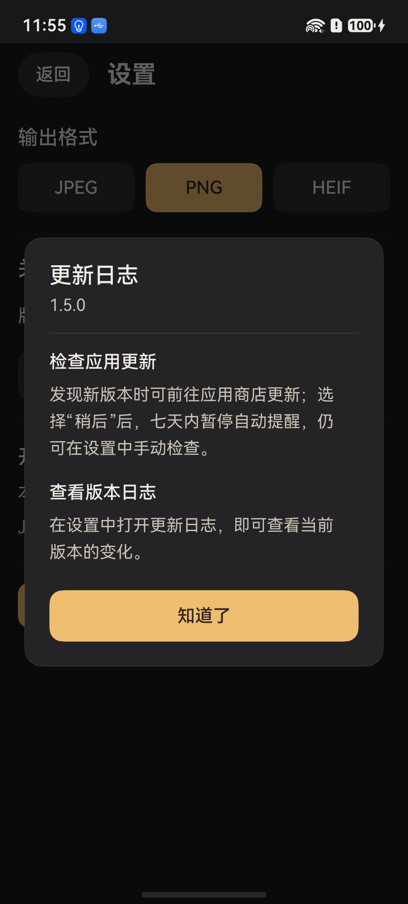
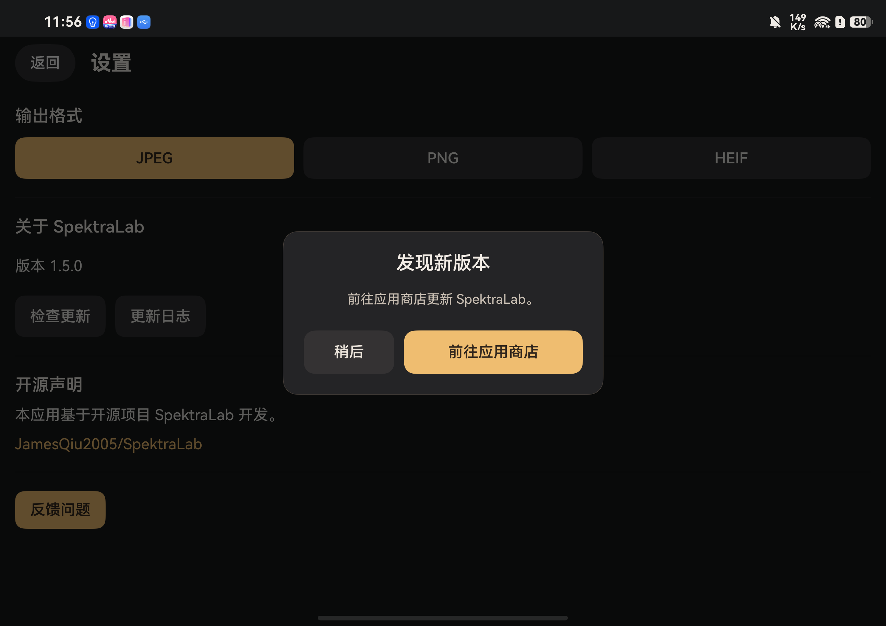
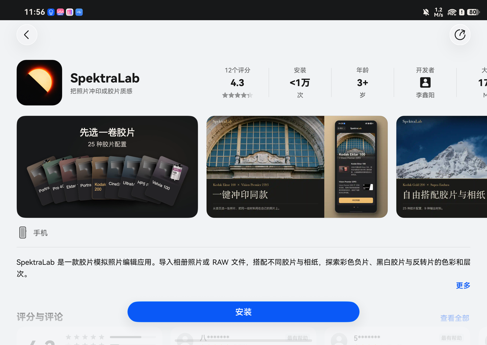
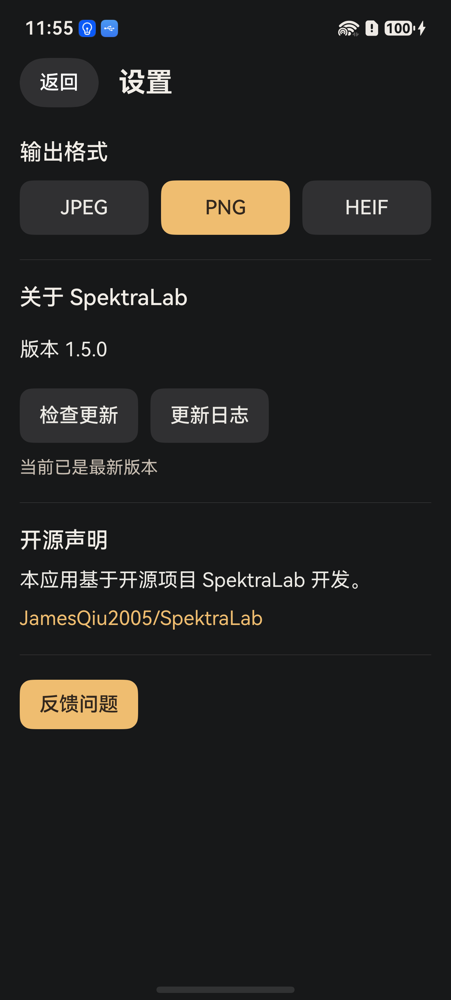

## SpektraLab 1.5.0 发行审阅

**材料检查和独立证据复核通过** · 版本码 10 · 对照 1.4.0 · 北京时间 2026-11-18

构建源码：`9ad270bd5556459772dfc7a8ac631e07ac685ab1`

### 更新内容

- 发现新版本时可前往应用商店更新；选择稍后可暂停自动提醒七天
- 设置页可手动检查更新，并查看当前版本日志

### 商店更新日志

发现新版本时可前往应用商店更新；选择“稍后”后，七天内暂停自动提醒，仍可在设置中手动检查。在设置中打开更新日志，即可查看当前版本的变化。

### 实机验收截图

**E01 · 直板屏：设置与 1.5.0 版本日志** · 通过

正常候选 · 直板屏真机 · 1280 × 2832 · 2026-11-18 11:57

操作：在设置中打开更新日志。结果：弹窗显示 1.5.0 及两项发行变化。

**E02 · 宽屏：发现新版本与更新提示布局** · 通过

诊断构建 · 宽屏真机 · 2584 × 1828 · 2026-11-18 11:57

操作：注入有更新状态后，在设置中手动检查。结果：发现新版本弹窗居中显示，稍后与前往应用商店按钮完整可见。

**E03 · AppGallery：打开 SpektraLab 商店详情** · 通过

诊断构建 · 宽屏真机 · 2584 × 1828 · 2026-11-18 11:57

操作：点按前往应用商店并等待加载。结果：进入 AppGallery 中真实的 SpektraLab 详情页。

**E04 · 设置：手动检查更新结果** · 通过

正常候选 · 直板屏真机 · 1280 × 2832 · 2026-11-18 11:57

操作：在设置中点按检查更新。结果：页面显示当前已是最新版本。

测试结果、软件包与签名

- 通过 · release 构建通过；包内版本 1.5.0（10），调试模式关闭
- 通过 · 七天提醒、版本日志一致性与宽屏布局规则测试
- 通过 · 指定真机覆盖安装并启动
- 通过 · 发行 APP 整包签名、发行 profile 和未签名 HAP 验证
- 通过 · AppGallery 鉴权、应用匹配与上传权限检查

- 发行签名 APP · SHA-256：`cf0d67ad991a0f80cdb416bca19779ca64440bae0613d485234322c235d7d007`
- 未签名 HAP · SHA-256：`65c56f8e7f6d15979fb16b8e5e049d53a36b97fbd1bfaf4877f8e43d831db515`
- 完整材料清单 · SHA-256：`ae8d0ecaa90de5972286e6e6b739fcd217ff8e06bce760f8f1d38d023339c620`

### 审阅与发布

请在本 PR 留下意见。维护者批准并合并最终候选后，本机核对材料，再上传 APP、写入更新日志并提交华为应用商店审核。
