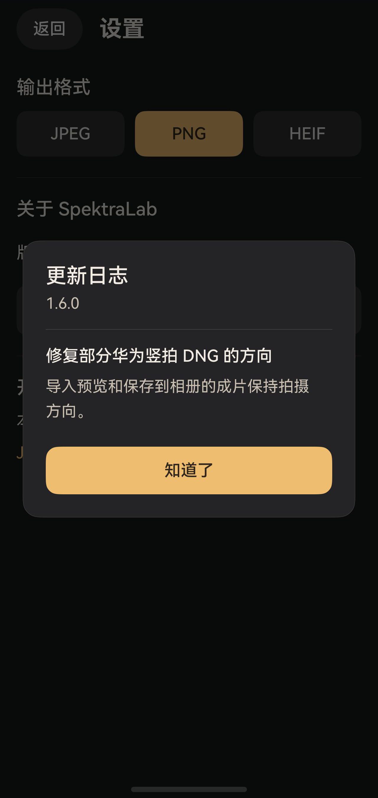

## SpektraLab 1.6.0 发行审阅

候选版本 **1.6.0（11）** · 对照 **1.5.0** · 北京时间 **2026-11-19 14:43**

构建源码 `cf2a38ad6be54839916935130ae63a71d0ee5445`

### 更新内容

修复部分华为竖拍 DNG 的方向。导入预览和保存到相册的成片保持拍摄方向。 [更新说明](1.6.0.md)

当内嵌 JPEG 与 RAW 的宽高互换时，比对两种旋转角度下的亮度分布。匹配明确后，导入预览、冲印预览和全尺寸导出共用同一角度。

### 实机验收

签名调试包覆盖安装并启动。在指定手机上对三张华为 Mate 70 Air DNG 执行导入、冲印和保存。读回相册中的全尺寸 PNG，核对像素朝向与各自内嵌预览一致。

| 样本 | RAW 校正 | 预览 | 导出 PNG |
| --- | --- | --- | --- |
| 正向竖拍（相册导入） | 顺时针 90° | 1536×2048 | 3072×4096 |
| 反向竖拍（文件导入） | 逆时针 90° | 1536×2048 | 3072×4096 |
| 横拍（文件导入） | 0° | 2048×1536 | 4096×3072 |

设置页更新日志显示 1.6.0 及本版修复内容。截图已裁去系统状态栏。

### 构建和签名

- release 构建通过，包内版本为 1.6.0（11），调试模式关闭。
- 自动回归通过，覆盖照片像素、导出文件名、界面交互、更新规则和版本日志。
- 未签名 HAP 和发行 APP 的应用代码与原生库一致，APP 整包验签通过，profile 为 release / app_gallery。
- AppGallery 鉴权、应用匹配、上传权限和本机材料清单校验通过。

### 材料校验值

| 材料 | SHA-256 |
| --- | --- |
| release 未签名 HAP | `85c8d1463325fe615cd000b2d3a6b840ed77fff00334049d4dce35b8083095a7` |
| 发行签名 APP | `e66cb9f01dfc2b55d0997157053cfcdbd15c1645497fca3eddfb51028daae7d7` |
| 中文更新日志 | `02d4637c669cc93e7a5cd2d3f162a7fc72b6209d016d960cbdf026e45386d9bf` |
| 完整材料清单 | `2607c82e2a678d8b7afa1e615c40842b2e4fc055b51b8547b6f04d7c49ee07a9` |
| 实机更新日志截图 | `3b1f77fad1ea2bacee1c9b7cc7990b55981f7772fd32dad8197e64736e919ad9` |

### AppGallery 提审

当前已上架版本为 1.5.0。候选获正式批准并合并后，核对 AppGallery 升级草稿，复用匹配的软件包或上传并绑定已验签的 1.6.0 APP，填写下列中文更新日志并提交审核。

> 修复部分华为竖拍 DNG 的方向。导入预览和保存到相册的成片保持拍摄方向。
