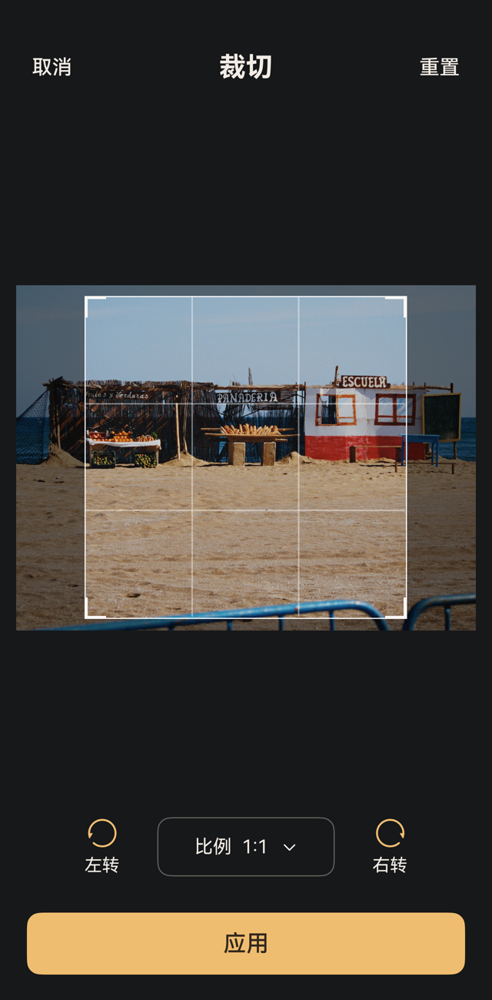
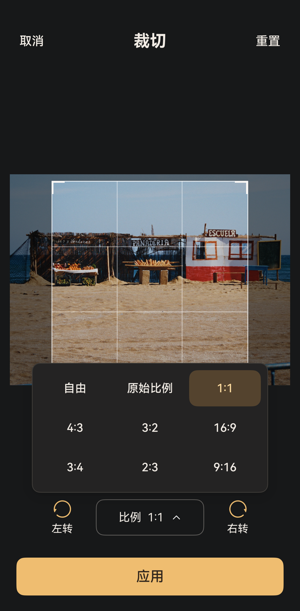
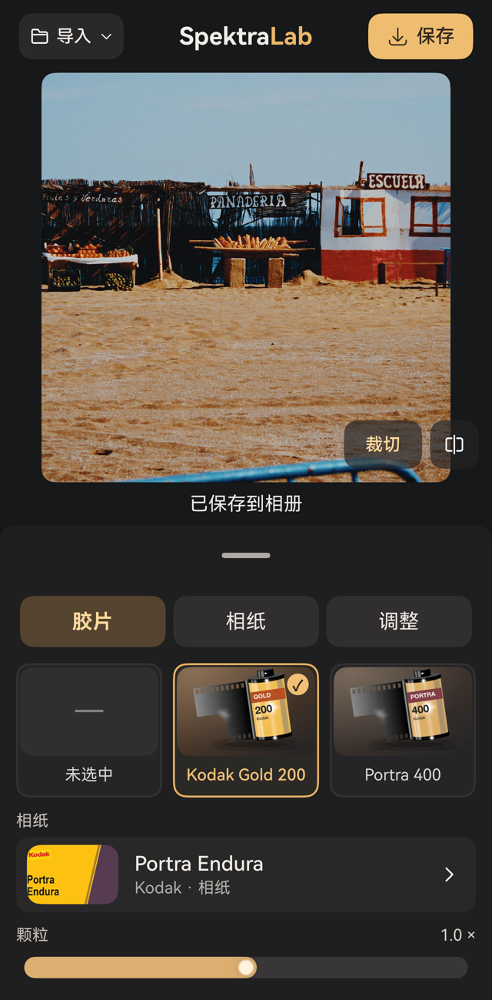

## SpektraLab 1.7.0 发行审阅

候选版本 **1.7.0（12）**，对照 **1.6.0**，北京时间 **2026-11-20 18:07**。构建源码为 `5991ded27807ca526686ddd1e8bfb66ff66eccd3`。

### 用户可见变化

- **照片裁切与旋转**：在照片预览打开裁切，可自由裁切、锁定原始比例或选择常用横竖比例，并向左或向右旋转 90°。
- **按构图保存照片**：普通照片可直接保存裁切与旋转结果，冲印成片也会保留同一构图。

[更新说明](1.7.0.md)

### 实机体验

| 1:1 裁切 | 比例菜单 | 冲印保存 |
| --- | --- | --- |
|  |  |  |

### 验证结果

- DevEco release 构建与自动回归通过，包内版本为 1.7.0（12）。
- 同一源码的签名调试包在指定手机覆盖安装并启动。
- JPEG 真机通过比例选择、左右旋转、重置、拖动裁切和应用。
- 直接保存和使用 Kodak Gold 200 冲印后保存均完成，PNG 为 2244 × 2244。
- 未签名 HAP 和发行 APP 内的应用代码及原生库一致，整包验签通过，profile 为 release / app_gallery。
- AppGallery 鉴权、应用匹配、上传权限和材料清单校验通过。

### 发行材料

| 材料 | SHA-256 |
| --- | --- |
| release 未签名 HAP | `bdc7e0d570586227458637a39a37b5ea762d49c0e71ddf10f823a93fa23f12d1` |
| 发行签名 APP | `13fd38bde9f00acb5c43cce2bd109681a4de33b6f9d1975ede89783f1ffb6fe1` |
| 中文更新日志 | `e7359a6f2fe74456af2d304a0bfd80cd1f1dc01ef0f3e6fda99a0d9193493c48` |
| 完整材料清单 | `078aeb7e0c2297f8398bbe24cea367b939d12969f38e6dcc8780d7afca1be984` |
| 1:1 裁切截图 | `5b2c0f64aee949cc3149ad49ea11ffa0629e99249eb9942a068878dbefd0db8c` |
| 比例菜单截图 | `18152387d4ac9c95ec667a2731398e06953f6362c760a0370d93e8f1720a795c` |
| 冲印保存结果截图 | `16955430a05c669d04987a70193b7d26b36de016ce739e49b1846242a8bebaf5` |

### 待批准的发行操作

正式批准后合并候选，在 GitHub Release 发布 release 模式的未签名 HAP。核对 AppGallery 的 1.7.0 升级草稿及软件包后，绑定已验签的发行 APP，填写下方更新日志并提交审核。

照片裁切与旋转。在照片预览打开裁切，可自由裁切、锁定原始比例或选择常用横竖比例，并向左或向右旋转 90°。

按构图保存照片。普通照片可直接保存裁切与旋转结果，冲印成片也会保留同一构图。
