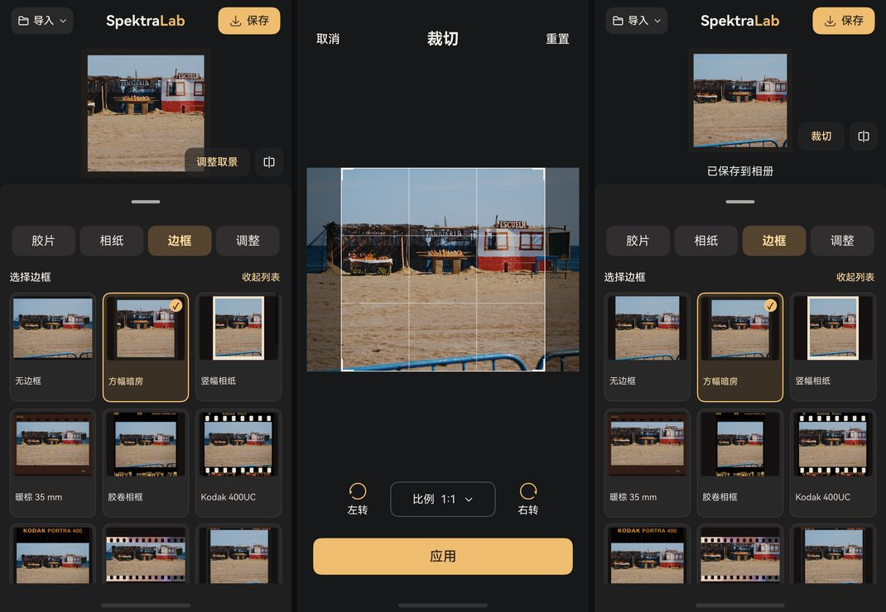
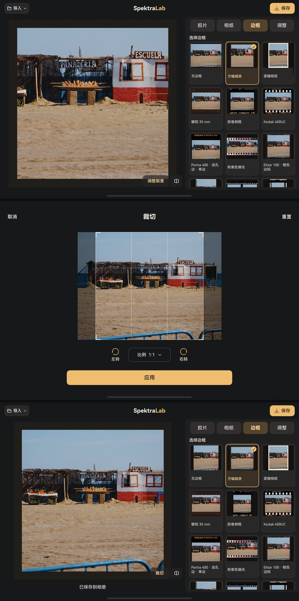

## SpektraLab 1.8.0 发行审阅

候选版本 **1.8.0（13）**，对照 **1.7.0**，北京时间 **2026-11-23 16:00**。构建源码为 `ae518f64c86a1d5d19fc5db6318211f71b60e7d0`。本次发行包含边框编辑 #6 和回归测试 #5。

### 用户可见变化

- **边框与实时预览**：在「相纸」和「调整」之间新增「边框」，可在当前照片上实时预览 41 款边框，包括此前提供的全部款式。
- **边框取景调整**：遇到会裁去画面的边框时，可按开口比例拖动或缩放取景框。切回同一款边框时恢复取景，保存成片沿用预览构图。
- **长按排序**：边框、胶片和相纸支持长按拖动。收起和展开使用同一顺序，重启后保留；「无边框」固定在首位。

[更新说明](1.8.0.md)

### 审阅意见修复

修复了在自定义边框取景后应用普通裁切时仍显示旧取景的问题。普通裁切改变构图后，边框预览、缩略图和保存结果采用新裁切。直板机上的旧候选可复现，新候选在直板机和 HOP 均通过。

| 直板机裁切与保存 | HOP 裁切与保存 |
| --- | --- |
|  |  |

### 上一轮双机功能验收

以下为前一轮 **1.8.0（13）** 的功能验收截图，构建提交为 `6ee08a0`。本轮新增的裁切和边框资源核对结果见上方与下方。

| 功能 | 直板机 | HOP |
| --- | --- | --- |
| 边框入口、实时缩略图和选框 | [截图](evidence/1.8.0/bar-selection.jpg) | [截图](evidence/1.8.0/hop-selection.jpg) |
| 横条与网格共用顺序、长按拖动、固定首项 | [横条](evidence/1.8.0/bar-strip.jpg) · [网格](evidence/1.8.0/bar-order.jpg) | [截图](evidence/1.8.0/hop-order.jpg) |
| 重启后保留顺序 | [截图](evidence/1.8.0/bar-restart.jpg) | [截图](evidence/1.8.0/hop-restart.jpg) |
| 固定比例取景与应用 | [截图](evidence/1.8.0/bar-framing.jpg) | [截图](evidence/1.8.0/hop-framing.jpg) |
| 进入普通裁切 | [截图](evidence/1.8.0/bar-crop.jpg) | [截图](evidence/1.8.0/hop-crop.jpg) |
| 保存至相册 | [截图](evidence/1.8.0/bar-save.jpg) | [截图](evidence/1.8.0/hop-save.jpg) |
| 胶片长按排序 | [截图](evidence/1.8.0/bar-film.jpg) | [截图](evidence/1.8.0/hop-film.jpg) |
| 相纸长按排序 | [截图](evidence/1.8.0/bar-paper.jpg) | [截图](evidence/1.8.0/hop-paper.jpg) |

首次展开提示见[边框候选验收截图](https://raw.githubusercontent.com/MusherM/SpektraLab-Harmony/9d45fdb97ed38800cae1065d8e2443cae90d3f11/dev/releases/evidence/border-editor/bar-order.jpg)。

### 验证结果

- 1.8.0（13）release 构建、签名调试 HAP 构建及本机自动回归通过。
- 直板机和 HOP 覆盖安装本轮调试包，同角度应用普通 1:1 裁切后，预览和保存均使用新裁切。
- 直板机和 HOP 均可选择原有 Kodak 400UC 并调整取景。调试 HAP、发行 HAP 和签名 APP 内的 37 个边框资源逐个与原资源校验一致。
- 签名 APP 对应的五组 RAW 方向验收全部通过，包括实拍华为 Mate 70 Air DNG 的 90° 预览补偿。
- release 未签名 HAP 与 APP 内的 ArkTS 字节码和原生库一致。发行 APP 验签通过，profile 为 release / app_gallery。
- AppGallery 鉴权、应用匹配、上传权限及本轮材料清单校验通过。

### 发行材料

| 材料 | SHA-256 |
| --- | --- |
| release 未签名 HAP | `38436f2c512bb52e14df5d61af78c53182be94174dc0b40e6b1767bdc1e2a66f` |
| 发行签名 APP | `a1339410cdeb6b502aee8411ef4342feec5bab594232a185262e2b198e0080b7` |
| 中文更新日志 | `b0f113bdcb35f8577d498ef6a2ce650821bf653822fbb7a9d0aa92d46581b715` |
| 完整材料清单 | `e99ea8269b810912803b53e2206b7c23eb44ddd5f3ef384db02ff2969089021e` |
| RAW 方向验收记录 | `53f026e441fa72bbebbfbfb1f7d5d05b4a1c741049647cdaaf594544983b5e70` |
| 边框资源清单 | `7683d4c3eea2493dd0b5f3f18a65754019fe6b7e0da9f6e48a8a5348d884a405` |

### 待批准的发行操作

正式批准后合并候选，在 GitHub Release 发布 release 模式未签名 HAP。在 AppGallery 核对 1.8.0 升级草稿和软件包后，绑定已验签的发行 APP，填写以下更新日志并提交审核。

边框与实时预览。在「相纸」和「调整」之间新增「边框」，可在当前照片上实时预览 41 款边框，包括此前提供的全部款式。
边框取景调整。遇到会裁去画面的边框时，可按开口比例拖动或缩放取景框。切回同一款边框时恢复取景，保存成片沿用预览构图。
长按排序。边框、胶片和相纸支持长按拖动。收起和展开使用同一顺序，重启后保留；「无边框」固定在首位。
