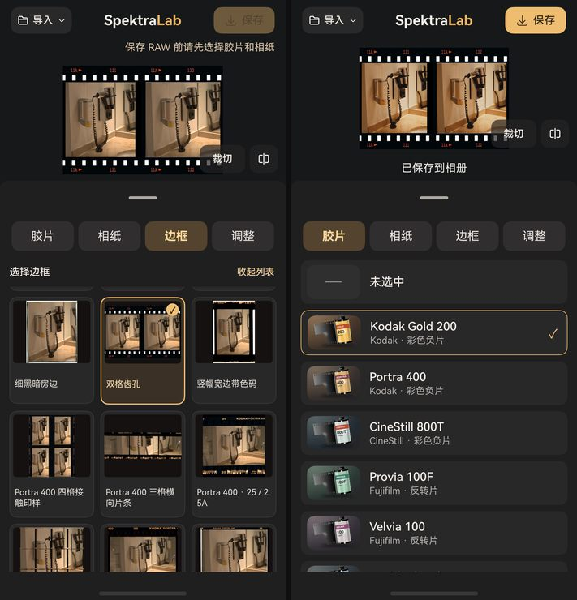
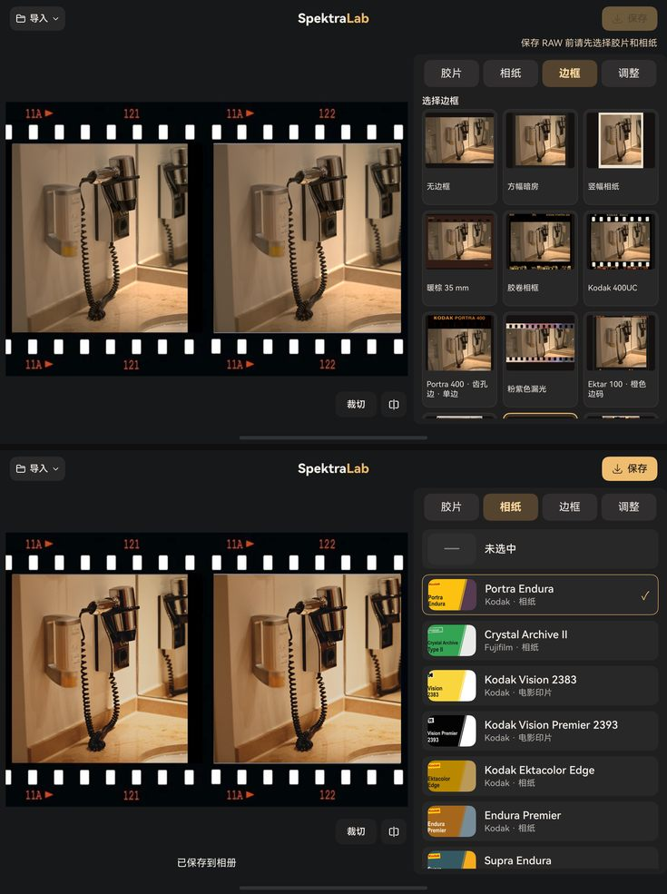

## SpektraLab 1.8.0 发行审阅

候选版本 **1.8.0（13）**，对照 **1.7.0**，北京时间 **2026-11-23 16:34**。构建源码为 `2674cbcf022302b3431dc469938d1c824abfc448`。本 PR 接替 #7，包含边框编辑与 #5 的回归测试。

### 用户可见变化

- **边框与实时预览**：在「相纸」和「调整」之间新增「边框」，可在当前照片上实时预览 41 款边框，包括此前提供的全部款式。
- **边框取景调整**：部分会裁去画面的单开口边框支持按开口比例拖动或缩放取景框。切回同一款边框时恢复取景，保存成片沿用预览构图。
- **长按排序**：边框、胶片和相纸支持长按拖动。收起和展开使用同一顺序，重启后保留；「无边框」固定在首位。
- **RAW 保存提示**：保存需要同时选择胶片和相纸，保存入口会提示还缺哪一项。

[更新说明](1.8.0.md)

### #7 审阅反馈

- **双格齿孔**：两个开口各自居中取景，照片仍可通过「裁切」改变整体构图。发行说明明确边框取景调整适用于部分会裁切画面的单开口边框。
- **RAW 保存**：沿用胶片和相纸的冲印条件。保存入口提示缺少的材料。首次选胶片或相纸后，应用会自动搭配另一项，两项齐全后即可保存。

| 直板机 RAW 提示与保存 | HOP RAW 提示与保存 |
| --- | --- |
|  |  |

### 此前双机验收

构建提交 `ae518f6` 的同角度裁切复验见[直板机](evidence/1.8.0-r2/bar-crop-precedence.jpg)与 [HOP](evidence/1.8.0-r2/hop-crop-precedence.jpg)。下表是构建提交 `6ee08a0` 的功能验收。

| 功能 | 直板机 | HOP |
| --- | --- | --- |
| 边框入口、实时缩略图和选框 | [截图](evidence/1.8.0/bar-selection.jpg) | [截图](evidence/1.8.0/hop-selection.jpg) |
| 横条与网格共用顺序、长按拖动、固定首项 | [横条](evidence/1.8.0/bar-strip.jpg) · [网格](evidence/1.8.0/bar-order.jpg) | [截图](evidence/1.8.0/hop-order.jpg) |
| 重启后保留顺序 | [截图](evidence/1.8.0/bar-restart.jpg) | [截图](evidence/1.8.0/hop-restart.jpg) |
| 固定比例取景与应用 | [截图](evidence/1.8.0/bar-framing.jpg) | [截图](evidence/1.8.0/hop-framing.jpg) |
| 进入普通裁切 | [截图](evidence/1.8.0/bar-crop.jpg) | [截图](evidence/1.8.0/hop-crop.jpg) |
| 保存至相册 | [截图](evidence/1.8.0/bar-save.jpg) | [截图](evidence/1.8.0/hop-save.jpg) |
| 胶片长按排序 | [截图](evidence/1.8.0/bar-film.jpg) | [截图](evidence/1.8.0/hop-film.jpg) |
| 相纸长按排序 | [截图](evidence/1.8.0/bar-paper.jpg) | [截图](evidence/1.8.0/hop-paper.jpg) |

### 验证结果

- 1.8.0（13）release 构建、签名调试 HAP 构建及本机自动回归通过。
- 直板机和 HOP 使用公开 Canon CR2 验证双格齿孔预览、RAW 保存提示及补齐材料后的相册成片。
- 调试 HAP、发行 HAP 和签名 APP 内的 37 个原有边框资源逐个校验一致。版本共提供 41 款边框。
- 签名 APP 绑定的五组 RAW 方向验收全部通过，包括实拍华为 Mate 70 Air DNG。
- release 未签名 HAP 与 APP 内的 ArkTS 字节码和原生库一致。发行 APP 验签通过，profile 为 release / app_gallery。
- AppGallery 鉴权、应用匹配、上传权限及本轮材料清单校验通过。

### 发行材料

| 材料 | SHA-256 |
| --- | --- |
| release 未签名 HAP | `ed18cb984ebe3c2c0488368c288508017b56c51dff908d0bab155781226f5a1a` |
| 发行签名 APP | `fcd97a160875b5153e9c6638c8c47efd3f8061c429d97f0e74e55f2d7b63ee0e` |
| 中文更新日志 | `a0c81f72d5a2577fe8c53efa46a424d4a262750727f87e324b9c57c1c1c8b4c8` |
| 完整材料清单 | `06f065436d83ef16d1e346a5742bafb54512703916dd2038b4fd9ea80636808b` |
| RAW 方向验收记录 | `1b287d56bb1183d3c26acff66051e642652b2e4b680b4c88630ed703d9c58024` |
| 边框资源清单 | `7683d4c3eea2493dd0b5f3f18a65754019fe6b7e0da9f6e48a8a5348d884a405` |

### 待批准的发行操作

正式批准后合并候选，在 GitHub Release 发布 release 模式未签名 HAP。在 AppGallery 核对 1.8.0 升级草稿和软件包后，绑定已验签的发行 APP，填写以下更新日志并提交审核。

边框与实时预览。在「相纸」和「调整」之间新增「边框」，可在当前照片上实时预览 41 款边框，包括此前提供的全部款式。
边框取景调整。部分会裁去画面的单开口边框支持按开口比例拖动或缩放取景框。切回同一款边框时恢复取景，保存成片沿用预览构图。
长按排序。边框、胶片和相纸支持长按拖动。收起和展开使用同一顺序，重启后保留；「无边框」固定在首位。
RAW 保存提示。保存需要同时选择胶片和相纸，保存入口会提示还缺哪一项。
