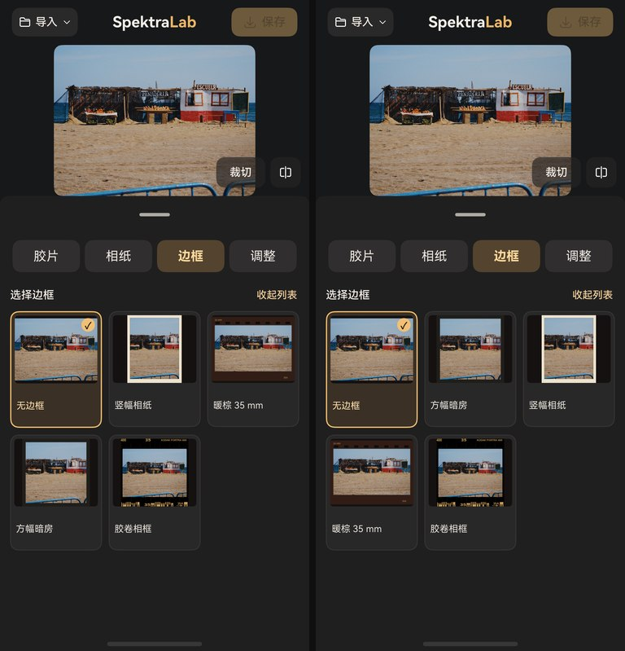
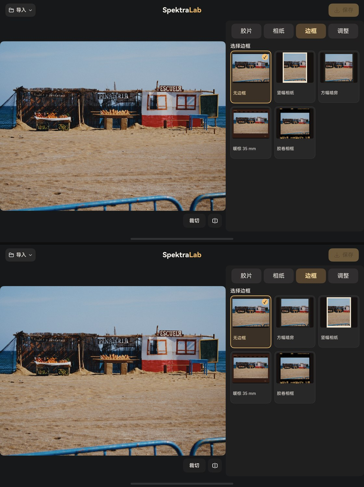

## SpektraLab 1.8.0 发行审阅

候选版本 **1.8.0（13）**，对照 **1.7.0**，北京时间 **2026-11-23 14:49**。构建源码为 `6ee08a096cd8f0e7bcd3cdd3997fa68afcd81e39`。本次发行包含边框编辑 #6 和回归测试 #5。

### 用户可见变化

- **边框与实时预览**：在「相纸」和「调整」之间新增「边框」，可在当前照片上实时预览四款内置边框。
- **边框取景调整**：遇到会裁去画面的边框时，可按开口比例拖动或缩放取景框。切回同一款边框时恢复取景，保存成片沿用预览构图。
- **长按排序**：边框、胶片和相纸支持长按拖动。收起和展开使用同一顺序，重启后保留；「无边框」固定在首位。

[更新说明](1.8.0.md)

### 双机真机验收

直板机和 HOP 都安装了 1.8.0 候选调试包。HOP 宽屏默认显示侧边网格，两台设备保存的成片均为 2880 × 2880，构图与预览一致。

| 功能 | 直板机 | HOP |
| --- | --- | --- |
| 边框入口、实时缩略图和选框 | [截图](evidence/1.8.0/bar-selection.jpg) | [截图](evidence/1.8.0/hop-selection.jpg) |
| 横条与网格共用顺序、长按拖动、固定首项 | [横条](evidence/1.8.0/bar-strip.jpg) · [网格](evidence/1.8.0/bar-order.jpg) | [截图](evidence/1.8.0/hop-order.jpg) |
| 重启后保留顺序 | [截图](evidence/1.8.0/bar-restart.jpg) | [截图](evidence/1.8.0/hop-restart.jpg) |
| 固定比例取景与应用 | [截图](evidence/1.8.0/bar-framing.jpg) | [截图](evidence/1.8.0/hop-framing.jpg) |
| 进入普通裁切 | [截图](evidence/1.8.0/bar-crop.jpg) | [截图](evidence/1.8.0/hop-crop.jpg) |
| 保存至相册 | [截图](evidence/1.8.0/bar-save.jpg) | [截图](evidence/1.8.0/hop-save.jpg) |
| 胶片长按排序 | [截图](evidence/1.8.0/bar-film.jpg) | [截图](evidence/1.8.0/hop-film.jpg) |
| 相纸长按排序 | [截图](evidence/1.8.0/bar-paper.jpg) | [截图](evidence/1.8.0/hop-paper.jpg) |

| 直板机网格排序 | HOP 网格排序 |
| --- | --- |
|  |  |

首次展开提示见[边框候选验收截图](https://raw.githubusercontent.com/MusherM/SpektraLab-Harmony/9d45fdb97ed38800cae1065d8e2443cae90d3f11/dev/releases/evidence/border-editor/bar-order.jpg)。

### 验证结果

- 1.8.0（13）release 构建、签名调试 HAP 构建及本机自动回归通过。
- 直板机和 HOP 用同一候选调试包覆盖安装并启动，验证边框、胶片和相纸长按排序、边框重启记忆、取景和相册保存。两台设备成片均为 2880 × 2880。
- Canon CR2、Nikon NEF、Sony ARW、Fujifilm RAF 和实拍华为 DNG 的本机方向验收全部通过。
- release 未签名 HAP 与 APP 内的 ArkTS 字节码、原生库一致。发行 APP 验签通过，profile 为 release / app_gallery。
- AppGallery 鉴权、应用匹配、上传权限及本机材料清单校验通过。当前上架版本为 1.7.0。
- 公开回归工作流来自 #5，在 PR 和 main 上运行编辑器规则、RAW 显示、公开样片方向及解码工作线程测试。

| RAW 样片 | 方向验收 | 华为预览补偿 |
| --- | --- | --- |
| Canon CR2 | 通过 | — |
| Nikon NEF | 通过 | — |
| Sony ARW | 通过 | — |
| Fujifilm RAF | 通过 | — |
| 华为 Mate 70 Air DNG | 通过 | 90° |

### 发行材料

| 材料 | SHA-256 |
| --- | --- |
| release 未签名 HAP | `4c2ade0ff36774dd9d1e6b3d3cee2891c827b012a1e2a73cf56a34ed16594e06` |
| 发行签名 APP | `bd032ed0a41047aea81500c707e79c0aade3357b046dc2bd2178dd67702e50e0` |
| 中文更新日志 | `138575e0faf790dfbcdced0373bd067de5da594e8dc0ba66feb259e08cf48e1d` |
| 完整材料清单 | `930cd8ebee8a73dec7f767d1283f2354f06e5babb5184d7e33f402e33d17a2d1` |
| RAW 方向验收记录 | `73f89336d0399a034203ffda37a57241939193001aa8db32dee4c65ab32378ef` |

### 待批准的发行操作

正式批准后合并候选，在 GitHub Release 发布 release 模式未签名 HAP。在 AppGallery 核对 1.8.0 升级草稿和软件包后，绑定已验签的发行 APP，填写以下更新日志并提交审核。

边框与实时预览。在「相纸」和「调整」之间新增「边框」，可在当前照片上实时预览四款内置边框。
边框取景调整。遇到会裁去画面的边框时，可按开口比例拖动或缩放取景框。切回同一款边框时恢复取景，保存成片沿用预览构图。
长按排序。边框、胶片和相纸支持长按拖动。收起和展开使用同一顺序，重启后保留；「无边框」固定在首位。
