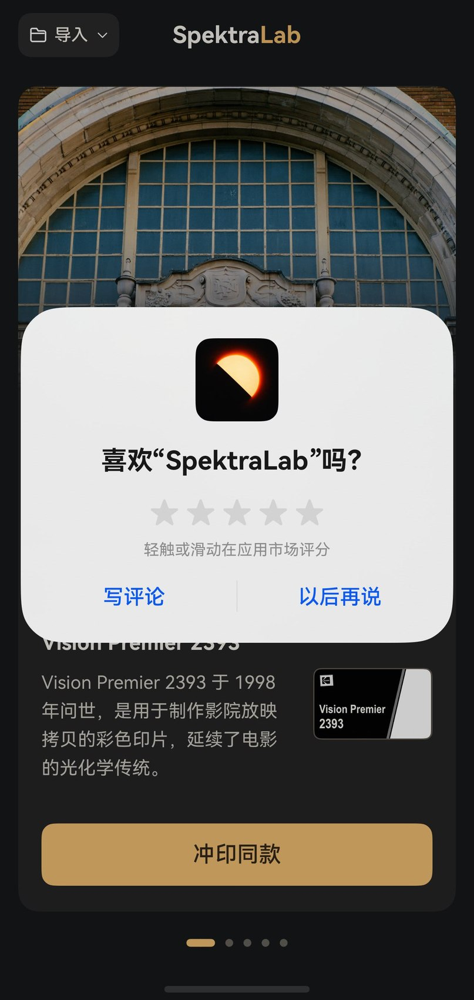
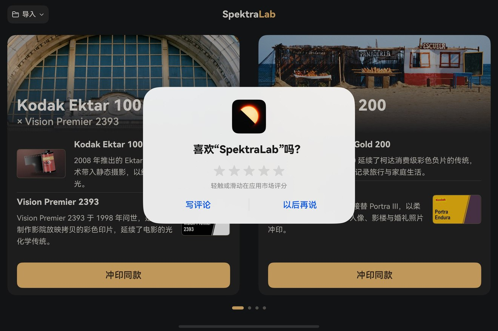

## SpektraLab 1.9.0 发行审阅

候选版本 **1.9.0（14）**，对照 **1.8.0**。验收时间为北京时间 **2026-11-24 15:48**，构建源码为 `c6b284996ca6604fbf2845cff5c1161f3e5b4e05`。

### 用户可见变化

- **多格边框取景**：拼接边框也可拖动和缩放取景，多个开口共享取景中心和缩放，保存沿用同一构图。
- **边框栏排版**：收起时与其他选项卡等高，横向浏览当前及相邻边框的缩略图与名称。
- **分页拖动选款**：胶片、相纸和边框可通过分页指示器选款。按住展开细轨道，横拖显示扇形卡片，松手应用所选款式。
- **中断导入、冲印与保存**：导入、冲印和检查更新可中断。保存完成前可请求取消，确认后停止；替换照片前会确认未保存的调整。
- **应用内评分与评论**：在至少两天内累计成功保存三张照片后，回首页时可能显示华为应用市场弹窗。每版最多尝试一次，间隔至少 30 天；确认已评价后在本机停止邀请。
- **设置与反馈**：连续切换输出格式时保留最后一次选择。反馈入口移到设置页底部，准备邮件时可以取消。

[更新说明](1.9.0.md)

### 直板机与 HOP 截图

| 功能 | 直板机 | HOP 展开态 |
| --- | --- | --- |
| 多格边框取景 | [双格边框取景](evidence/1.9.0/bar-multi-frame.jpg) | [双格边框取景](evidence/1.9.0/hop-multi-frame.jpg) |
| 收起态边框栏同高与横向缩略图 | [同高底栏](evidence/1.9.0/bar-compact-border.jpg) | 展开态使用侧栏网格 |
| 分页指示器和三类选款 | [按住展开细轨道](evidence/1.9.0/bar-pager-hold.jpg) · [边框扇形](evidence/1.9.0/bar-pager-border.jpg) · [胶片扇形](evidence/1.9.0/bar-pager-film.jpg) · [相纸扇形](evidence/1.9.0/bar-pager-paper.jpg) · [仅一款相纸](evidence/1.9.0/bar-pager-paper-single.jpg) | 展开态从侧栏直接选款 |
| 替换照片与取消导入 | [替换照片确认](evidence/1.9.0/bar-replace-photo.jpg) · [导入中](evidence/1.9.0/bar-cancel-import-start.jpg) · [保留原编辑](evidence/1.9.0/bar-cancel-import-result.jpg) | [替换照片确认](evidence/1.9.0/hop-replace-photo.jpg) · [导入中](evidence/1.9.0/hop-cancel-import-start.jpg) · [保留原编辑](evidence/1.9.0/hop-cancel-import-result.jpg) |
| 取消冲印 | [冲印中](evidence/1.9.0/bar-cancel-render-start.jpg) · [停止冲印](evidence/1.9.0/bar-cancel-render-result.jpg) | [冲印中](evidence/1.9.0/hop-cancel-render-start.jpg) · [停止冲印](evidence/1.9.0/hop-cancel-render-result.jpg) |
| 确认取消保存及重新保存 | [取消保存确认](evidence/1.9.0/bar-cancel-save-confirm.jpg) · [保留材料和调整](evidence/1.9.0/bar-cancel-save-result.jpg) · [重新保存成功](evidence/1.9.0/bar-save-resumed.jpg) | [取消保存确认](evidence/1.9.0/hop-cancel-save-confirm.jpg) · [保留材料和调整](evidence/1.9.0/hop-cancel-save-result.jpg) · [重新保存成功](evidence/1.9.0/hop-save-resumed.jpg) |
| 华为评分与评论 | [官方评分与评论弹窗](evidence/1.9.0/bar-review-dialog.jpg) | [官方评分与评论弹窗](evidence/1.9.0/hop-review-dialog.jpg) |
| 切换输出格式与反馈入口 | [输出格式设置](evidence/1.9.0/bar-output-formats.jpg) · [反馈页面](evidence/1.9.0/bar-feedback.jpg) | [输出格式设置](evidence/1.9.0/hop-output-formats.jpg) · [反馈页面](evidence/1.9.0/hop-feedback.jpg) |
| 检查更新 | [检查更新结果](evidence/1.9.0/bar-update-check.jpg) · [输出格式设置](evidence/1.9.0/bar-output-formats.jpg) | [检查更新结果](evidence/1.9.0/hop-update-check.jpg) · [输出格式设置](evidence/1.9.0/hop-output-formats.jpg) |

### 官方评分弹窗

| 直板机 | HOP 展开态 |
| --- | --- |
|  |  |

### 验证结果

- 直板机与 HOP 展开态均覆盖安装并启动 1.9.0（14）。
- 两台设备均验证 RAW 导入取消、冲印取消、保存确认取消后保留原有编辑，并再次保存成功。
- 两台设备均从本地测试进度完成一次实际保存后回首页，显示华为官方评分框。星级保持为空，测试后恢复本地评分进度。
- 本机自动回归、公开 GitHub 回归及签名 APP 绑定的五组 RAW 方向验收通过。
- 调试 HAP、release 未签名 HAP 与发行 APP 含全部 41 款边框所需资源。37 张原边框图层的校验值与 1.8.0 一致。
- 发行 APP 内的 ArkTS 字节码和原生库与 release 未签名 HAP 一致。发行 APP 验签通过，profile 类型为 release，渠道为 app_gallery。
- AppGallery 鉴权、应用匹配、上传权限和本次发行材料的校验通过。
- 双机截图记录检查更新结果；直板机界面树捕获到取消检查按钮。
- 反馈截图覆盖入口和表单；取消邮件准备通过代码路径复核。

[候选源码的 GitHub Regression tests](https://github.com/MusherM/SpektraLab-Harmony/actions/runs/45350112521)

### 发行材料

| 材料 | SHA-256 |
| --- | --- |
| release 未签名 HAP | `431b71cd5764ea4b097447feb635c33098c640de6b4c44b2838f9d1d178adc1c` |
| 发行签名 APP | `d71c11f5c0e8e9bf737605dcfff28b5eace6bc1c869446e990beb95878eadf30` |
| 中文更新日志 | `e94a1e5c69d4523f4aebffb91a7054a9c7dee3dff1b4bf7e618558d3b82ef70c` |
| 完整材料清单 | `b3b369f00fe01f1483f339b7cdcc5b3154f7fd9d66f9dff8bc0d53db7b1472e4` |
| RAW 方向验收记录 | `f7b7c4c819c8e6e6244dc91ba3c29bd548aa5dc95f30fce12d336114b438e9f1` |
| 边框资源清单 | `80d498bef7d7d9edad1bd4eadb7d780bcd2b9f4bb38aaf5b62b512d8eafe11d7` |

### 待批准的发行操作

正式批准后合并候选，在 GitHub Release 发布 release 模式未签名 HAP。核对 AppGallery 升级草稿和软件包后，绑定 1.9.0 的发行 APP，填写中文更新日志并提审。

多格边框取景。拼接边框也可拖动和缩放取景，多个开口共享取景中心和缩放，保存沿用同一构图。
边框栏排版。收起时与其他选项卡等高，横向浏览当前及相邻边框的缩略图与名称。
分页拖动选款。胶片、相纸和边框可通过分页指示器选款。按住展开细轨道，横拖显示扇形卡片，松手应用所选款式。
中断导入、冲印与保存。导入、冲印和检查更新可中断。保存完成前可请求取消，确认后停止；替换照片前会确认未保存的调整。
应用内评分与评论。在至少两天内累计成功保存三张照片后，回首页时可能显示华为应用市场弹窗。每版最多尝试一次，间隔至少 30 天；确认已评价后在本机停止邀请。
设置与反馈。连续切换输出格式时保留最后一次选择。反馈入口移到设置页底部，准备邮件时可以取消。
