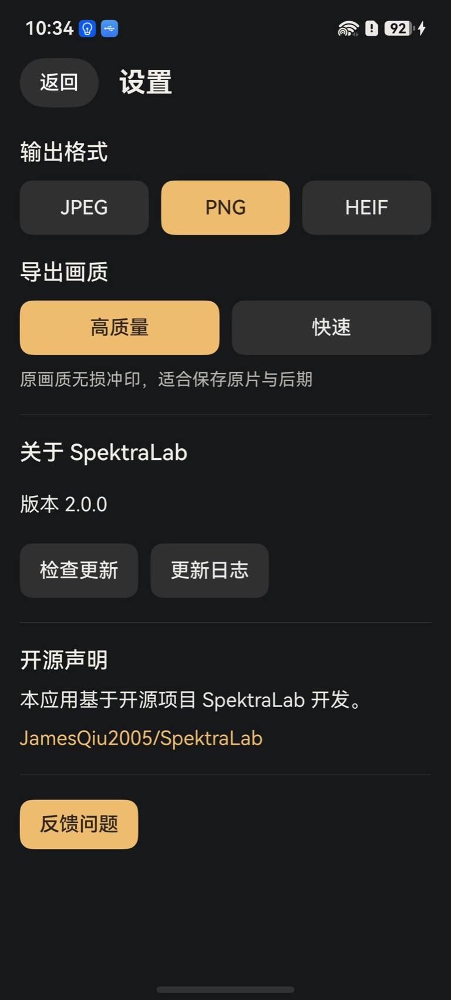
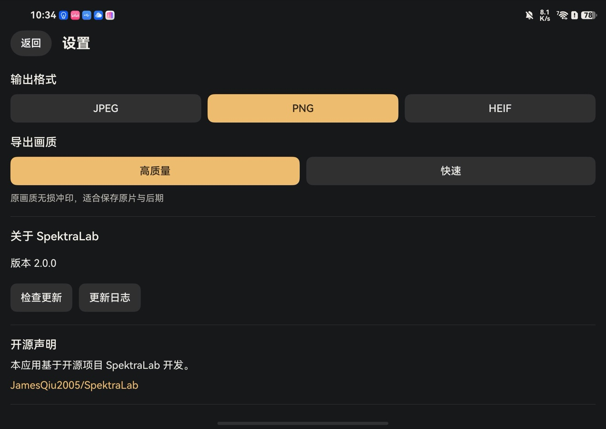
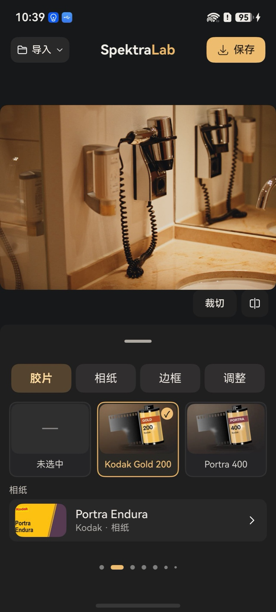
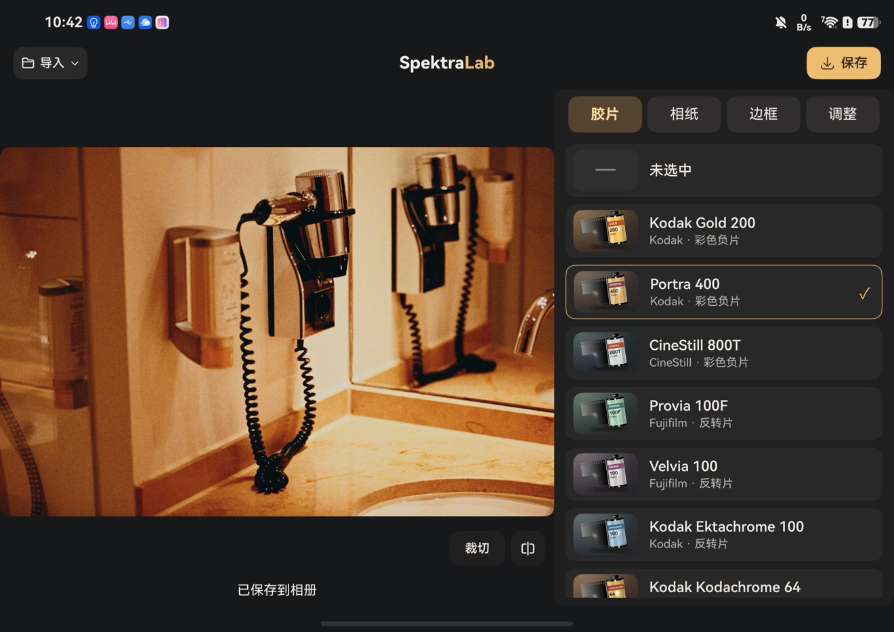

## SpektraLab 2.0.0 发行审阅

候选版本 **2.0.0（15）**，对照 **1.9.0**。验收时间为北京时间 **2026-11-25 10:42**，构建源码为 `9c3e01f68bf3a8e53b7f1970813dfbb82119c881`。

### 用户可见变化

- **冲印与导出提速**：重构底层 GPU 计算与内存复用管线，完整画质冲印和导出明显加快，结果保持无损一致。
- **极速预览与后台预解**：RAW 照片导入先以轻量化预览快速进入编辑页，同时在后台预解原片；调整相纸参数直接复用已冲印底片，减少重复等待。
- **导出画质选项**：设置页新增「导出画质」，可在保持原始无损结果的「高质量」与更快的「快速」模式之间切换。
- **资源更新校验**：引擎着色器与资源包升级时自动校验内容摘要，避免旧版缓存导致冲印异常。

[更新说明](2.0.0.md)

### 直板机与 HOP 截图

| 功能 | 直板机 | HOP 展开态 |
| --- | --- | --- |
| 导出画质（高质量 / 快速） | [高质量设置](evidence/2.0.0/bar-export-quality.jpg) · [快速设置](evidence/2.0.0/bar-export-quality-fast.jpg) | [高质量设置](evidence/2.0.0/hop-export-quality.jpg) · [快速设置](evidence/2.0.0/hop-export-quality-fast.jpg) |
| RAW 极速预览与后台预解 | [RAW 胶片预览](evidence/2.0.0/bar-raw-preview.jpg) | [RAW 胶片预览](evidence/2.0.0/hop-raw-preview.jpg) |
| 相纸切换复用冲印底片 | [切换相纸](evidence/2.0.0/bar-paper-switch.jpg) | [切换相纸](evidence/2.0.0/hop-paper-switch.jpg) |
| 完整画质导出与保存 | [导出保存成功](evidence/2.0.0/bar-export-saved.jpg) | [导出保存成功](evidence/2.0.0/hop-export-saved.jpg) |

### 导出画质与 RAW 预览实拍

| 直板机 | HOP 展开态 |
| --- | --- |
|  |  |
|  |  |

### 验证结果

- 直板机与 HOP 展开态均覆盖安装并启动 2.0.0（15）。
- 两台设备均验证设置页「导出画质」（高质量 / 快速）切换与说明文本更新，测试后恢复默认「高质量」。
- 两台设备均完成 `.CR2` RAW 照片导入、后台预解（直板机记录轻量化解码 693 ms + 显示 96 ms，后台全分辨率预解 1433 ms）、胶片渲染、相纸切换复用底片及保存写入相册成功。
- 本机脚本回归、原生 `raw_display` / `raw_decode` 语法检查及签名 APP 绑定的五组 RAW 方向验收通过。
- 调试 HAP、release 未签名 HAP 与发行 APP 含全部 41 款边框所需资源。37 张原边框图层的校验值与 1.9.0 一致。
- 发行 APP 内的 ArkTS 字节码和原生库与 release 未签名 HAP 一致。发行 APP 验签通过，profile 类型为 release，渠道为 app_gallery。
- AppGallery 鉴权、应用匹配、上传权限和本次发行材料的校验通过。

### 发行材料

| 材料 | SHA-256 |
| --- | --- |
| release 未签名 HAP | `f0a4b952c490c3055c701fea143e672d07b0faf1a2eced21be51f87477400d2d` |
| 发行签名 APP | `991b027c1cc5561e36c9e728f56d8a9c39f7972de0ddd596115b683771e91f49` |
| 中文更新日志 | `2a833feeb3b9bba681ff9206c4951f5a21c7ce40e169f3d4d499ff3a89667c2d` |
| 完整材料清单 | `82597ebe46701bba3b71848f98277c5fed0d0052626ab7342f7e84e0f97be28f` |
| RAW 方向验收记录 | `dfa728e35f44ef25070bf69ce32b83d4721f7bd8cbc9a9d37fbaf47209e44aa9` |
| 边框资源清单 | `80d498bef7d7d9edad1bd4eadb7d780bcd2b9f4bb38aaf5b62b512d8eafe11d7` |

### 待批准的发行操作

正式批准后合并候选，在 GitHub Release 发布 release 模式未签名 HAP。核对 AppGallery 升级草稿和软件包后，绑定 2.0.0 的发行 APP，填写中文更新日志并提审。

冲印与导出提速。重构底层 GPU 计算与内存复用管线，完整画质冲印和导出明显加快，结果保持无损一致。
极速预览与后台预解。RAW 照片导入先以轻量化预览快速进入编辑页，同时在后台预解原片；调整相纸参数直接复用已冲印底片，减少重复等待。
导出画质选项。设置页新增「导出画质」，可在保持原始无损结果的「高质量」与更快的「快速」模式之间切换。
资源更新校验。引擎着色器与资源包升级时自动校验内容摘要，避免旧版缓存导致冲印异常。
